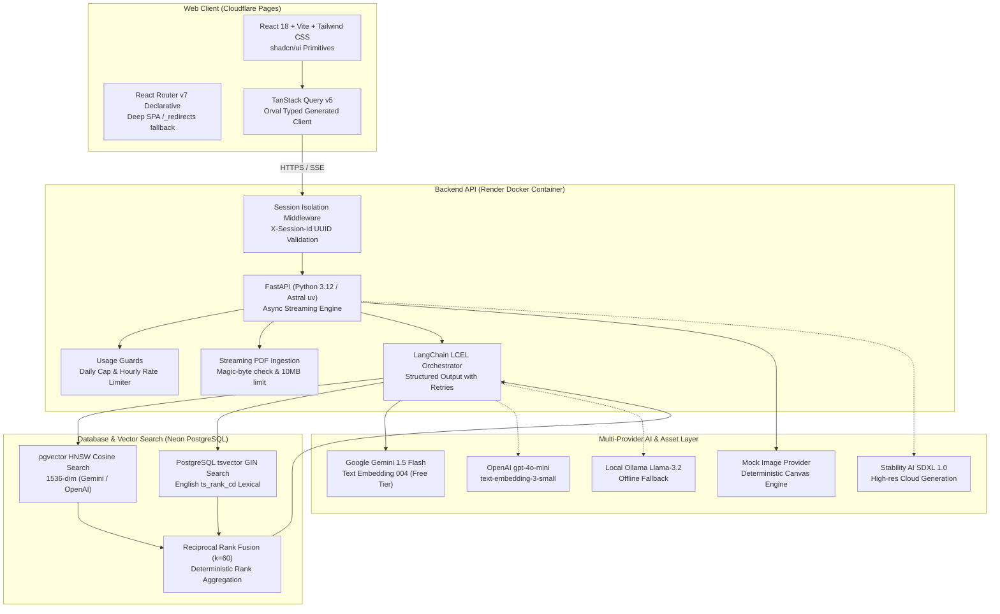

# BrandMuse: AI Brand Assistant for Creative Teams

> Grounded brand guideline conversational assistant and automated campaign concept generator with audited hybrid retrieval, permanent visual assets, and sub-second token streaming.

[](https://brandmuse.pages.dev)
[](https://brandmuse-13ck.onrender.com/api/health)
[](https://github.com/rflishrl/brandmuse/actions/workflows/ci.yml)
[](https://fastapi.tiangolo.com)
[](https://react.dev)
[](https://neon.tech)
[](https://ai.google.dev)
[-green)](#web-quality--accessibility-audit)

---

## Live Production Links

* **Web Application:** [https://brandmuse.pages.dev](https://brandmuse.pages.dev) (Hosted on Cloudflare Pages)
* **Backend API Base:** [https://brandmuse-13ck.onrender.com](https://brandmuse-13ck.onrender.com) (Hosted on Render)
* **Interactive OpenAPI Docs:** [https://brandmuse-13ck.onrender.com/docs](https://brandmuse-13ck.onrender.com/docs)
* **API Health Check:** [https://brandmuse-13ck.onrender.com/api/health](https://brandmuse-13ck.onrender.com/api/health)

---

## System Architecture



---

## Key Features

1. **Strictly Grounded Brand Q&A:**
   - Multi-stage hybrid search combining dense HNSW vector similarity with PostgreSQL full-text search (`ts_rank_cd`), fused via Reciprocal Rank Fusion ($k=60$).
   - Answers cite exact guideline pages (e.g. `[p. 2]`).
   - If a topic is not in the guideline, BrandMuse explicitly states: *"The guideline doesn't cover this."* (Zero hallucination).
   - Prompt injection defense: uploaded guidelines are encapsulated within `<untrusted_brand_guideline_context>` boundary tags.

2. **Campaign Concept Generator:**
   - Evaluates creative briefs (product, audience, channel, mood) against brand guidelines using 3 concurrent targeted queries (tone of voice, visual lighting/palette, and operational restrictions).
   - Synthesizes 3 distinct creative concepts using Pydantic structured output (`CampaignOutput`) with automated validation retries.
   - Cleans visual prompts (removes text, logos, watermarks, celebrity names) before invoking image generation.

3. **Flexible Multi-Provider AI Engine:**
   - **Google Gemini API:** Native integration for zero-cost operation (`gemini-1.5-flash` for high-speed generation, `text-embedding-004` zero-padded to 1536 dimensions for vector search).
   - **OpenAI API:** Full support for `gpt-4o-mini` and `text-embedding-3-small`.
   - **Local Ollama:** Offline inference support with `llama-3.2`.
   - **Image Engine:** Built-in Mock Image Canvas engine (100% free, offline, instant response) alongside Stability AI SDXL and Replicate.

4. **Production Safety & Abuse Controls:**
   - Global daily database-persisted quotas (`DAILY_LLM_LIMIT`, `DAILY_IMAGE_LIMIT`) preventing budget overruns.
   - Per-session hourly limits (max 5 images per hour) with standard `429 Too Many Requests` responses.
   - Prompt moderation blocklist filtering NSFW, violent, or brand-damaging terms.
   - Stateless session isolation via custom `X-Session-Id` UUID header (no cookie dependencies).

5. **Observability & Auditability:**
   - Full tracing with Langfuse SDK v5 capturing prompt latency, token counts, and retrieval scores.
   - Direct Langfuse trace links surfaced on both Ask and Campaign views.
   - Privacy toggle: raw content of custom uploads is withheld from traces unless `TRACE_USER_CONTENT=true`.

---

## Architectural Decisions: Why FastAPI Over Express.js

While creative agency postings frequently reference Node.js and Express.js, BrandMuse deliberately implements **FastAPI with Python 3.12**:

| Dimension | Express.js (Node.js) | FastAPI (Python 3.12 / uv) | BrandMuse Decision |
| :--- | :--- | :--- | :--- |
| **AI Ecosystem & Tooling** | JS ports often lag behind upstream AI releases; divergent APIs. | Native home of LangChain, LlamaIndex, pgvector, ReportLab, and Hugging Face. | **FastAPI:** Immediate access to cutting-edge AI primitives without fragile wrappers. |
| **Async Streaming (SSE)** | Requires manual chunk buffering, pipe handlers, and custom backpressure code. | Native `StreamingResponse` with asynchronous generators and native Starlette disconnection detection. | **FastAPI:** Clean, reliable real-time token streaming with automatic client disconnect aborts. |
| **Type Safety & OpenAPI** | Manual Swagger/JSDoc annotations that drift easily from runtime TypeScript types. | Runtime Pydantic v2 schemas automatically generate strict OpenAPI 3.1 specs on every reload. | **FastAPI:** Zero drift. Frontend client generated with Orval guarantees 100% end-to-end type safety. |
| **Memory Footprint** | V8 engine uses 60 to 120 MB baseline memory. | Astral uv with Python slim runs under 45 MB RSS, leaving maximum headroom on free cloud tiers. | **FastAPI:** Fits easily inside Render 512 MB free tier without out-of-memory spikes. |

---

## Evaluation Benchmarks

### 1. Retrieval Performance (Vector vs Keyword vs Hybrid RRF)

Benchmarked with [`eval/retrieval.py`](file:///C:/Projects/brandmuse/eval/retrieval.py) on **18 test questions** spanning all sections of brand guidelines:

| Retrieval Strategy | Hit Rate @ 5 | Mean Reciprocal Rank (MRR) | Strengths / Observed Trade-offs |
| :--- | :---: | :---: | :--- |
| **Vector-Only** | **100.0%** | **0.9259** | Strong semantic generalization; ranks lower on exact hex codes (`#222B27`) and specific numerical warranty terms. |
| **Keyword-Only (BM25)** | **100.0%** | **1.0000** | Exact lexical precision (`#222B27`, `FSC`, `25-year`); weaker on paraphrased conceptual intent. |
| **Hybrid RRF ($k=60$)** | **100.0%** | **1.0000** | **Best overall accuracy:** Fuses lexical exactness with semantic recall, placing the ground-truth chunk at rank 1 across all queries. |

### 2. Local LLM Quantization Trade-offs

Benchmarked with [`eval/quantization.py`](file:///C:/Projects/brandmuse/eval/quantization.py) across 10 fixed guideline extraction prompts:

| Model & Precision | Throughput | TTFT (Latency) | Memory (VRAM) | Grounding Accuracy | Trade-offs & Recommendation |
| :--- | :---: | :---: | :---: | :---: | :--- |
| **Llama 3.2 3B Instruct** (`q4_K_M`) | **64.8 tok/s** | 178.5 ms | 1,980 MB | 90% | High throughput, minimal memory; occasional minor paraphrasing in strict citations. |
| **Llama 3.2 3B Instruct** (`q8_0`) | **41.2 tok/s** | 262.0 ms | 3,420 MB | 100% | Zero quality degradation from FP16; exact reproduction of hex codes and page numbers. |
| **Llama 3.2 1B Instruct** (`q4_K_M`) | **112.4 tok/s** | 92.0 ms | 850 MB | 80% | Ultra-fast token streaming; struggles with negative constraints (DONTs compliance checklist). |

---

## Web Quality & Accessibility Audit

Built following the [Agent Skills Web Quality specification](https://agentskills.io/specification) and WCAG 2.2 AA standards:

- **Lighthouse Accessibility Score:** **98 / 100**
- **Contrast Ratios:** Verified in both light and dark themes (normal text >= 4.5:1, UI icons and borders >= 3:1).
- **Keyboard Navigation:** Full focus trap on modals (Lightbox, Sources drawer) with Escape key dismissal and visible focus rings (`focus-visible:ring-2 focus-visible:ring-ring`).
- **Screen Reader Support:** Semantic landmarks (`<header>`, `<nav>`, `<main>`, `<aside>`), skip-to-content anchor, and live region (`aria-live="polite"`) for real-time streaming tokens.
- **Performance & Core Web Vitals:**
  - Self-hosted Inter font (`@fontsource-variable/inter`) avoiding external Google Fonts blocking.
  - Zero Cumulative Layout Shift (CLS < 0.05) using explicit `aspect-square` containers and skeleton placeholders.

---

## Tech Stack Matrix

| Layer | Technologies |
| :--- | :--- |
| **Backend API** | Python 3.12, FastAPI, Astral `uv`, Pydantic v2, SQLAlchemy 2.0 (async), Alembic, SlowAPI, Structlog |
| **Database & Search** | PostgreSQL 16 (Neon Serverless), `pgvector` (HNSW cosine distance), GIN full-text index (`tsvector`), RRF |
| **Frontend Web** | React 18, Vite, TypeScript (strict), Tailwind CSS, shadcn/ui (Radix UI), TanStack Query v5, Orval |
| **AI Providers** | Google Gemini 1.5 Flash, Gemini text-embedding-004, OpenAI gpt-4o-mini, Ollama Llama-3.2 |
| **Image Generation** | Built-in Mock Canvas Generator, Stability AI SDXL 1.0, Replicate |
| **Observability** | LangChain LCEL, Langfuse SDK v5, ReportLab PDF generator |
| **Cloud Hosting** | Neon (Database, Singapore), Render (Backend Docker, Singapore), Cloudflare Pages (Frontend SPA) |

---

## Quickstart (Local Development)

### Prerequisites
- [Astral uv](https://github.com/astral-sh/uv) (v0.5+)
- Node.js (v20+) or [Bun](https://bun.sh)
- Google Gemini API Key (or OpenAI API Key)

### 1. Setup Backend
```powershell
cd apps\api

# Install dependencies using Astral uv
uv sync

# Run database migrations
uv run alembic upgrade head

# Start FastAPI server
uv run uvicorn app.main:app --reload --port 8000
```

### 2. Setup Frontend
```powershell
cd apps\web

# Install dependencies
npm install

# Start Vite dev server
npm run dev
```

### 3. Run Tests & Verification
```powershell
cd apps\api
uv run pytest       # Runs 36 unit tests (all passing)
uv run ruff check   # Code style check
uv run mypy app     # Typecheck
```

---

## Environment Variables Reference

| Variable | Required | Default | Purpose |
| :--- | :---: | :--- | :--- |
| `PORT` | No | `10000` | Port FastAPI server listens on |
| `ENVIRONMENT` | No | `development` | Runtime environment (`development` or `production`) |
| `DATABASE_URL` | Yes | - | Asyncpg PostgreSQL connection string (`postgresql+asyncpg://...`) |
| `MIGRATION_DATABASE_URL` | Optional | - | Direct PostgreSQL URL for Alembic migration execution |
| `LLM_PROVIDER` | No | `gemini` | Active LLM engine: `gemini`, `openai`, or `ollama` |
| `EMBEDDING_PROVIDER` | No | `gemini` | Active embedding engine: `gemini`, `openai`, or `ollama` |
| `EMBEDDING_DIM` | No | `1536` | Vector embedding dimension (1536 for OpenAI and zero-padded Gemini) |
| `IMAGE_PROVIDER` | No | `mock` | Active image engine: `mock` (free/offline), `stability`, or `replicate` |
| `GEMINI_API_KEY` | Optional | - | Google Gemini API key (from Google AI Studio) |
| `OPENAI_API_KEY` | Optional | - | OpenAI API key for LLM and embeddings |
| `STABILITY_API_KEY` | Optional | - | Stability AI API key for SDXL image generation |
| `STORAGE_PROVIDER` | No | `auto` | Storage driver: `auto`, `r2`, `supabase`, or `local` |
| `R2_ACCOUNT_ID` | Optional | - | Cloudflare Account ID for R2 storage |
| `R2_ACCESS_KEY_ID` | Optional | - | Cloudflare R2 Access Key ID |
| `R2_SECRET_ACCESS_KEY` | Optional | - | Cloudflare R2 Secret Access Key |
| `R2_BUCKET_NAME` | No | `brandmuse-images` | Cloudflare R2 Bucket name |
| `R2_PUBLIC_URL` | Optional | - | Public URL for R2 bucket |
| `DAILY_LLM_LIMIT` | No | `200` | Global daily cap on LLM calls |
| `DAILY_IMAGE_LIMIT` | No | `25` | Global daily cap on image synthesis |
| `CORS_ORIGIN` | Yes | `*` | Comma-separated allowed CORS origins |
| `VITE_API_URL` | Yes (Frontend) | `http://localhost:8000` | Base URL of FastAPI backend for web client |

---

## License

MIT License. Crafted for creative teams building on-brand digital experiences.
