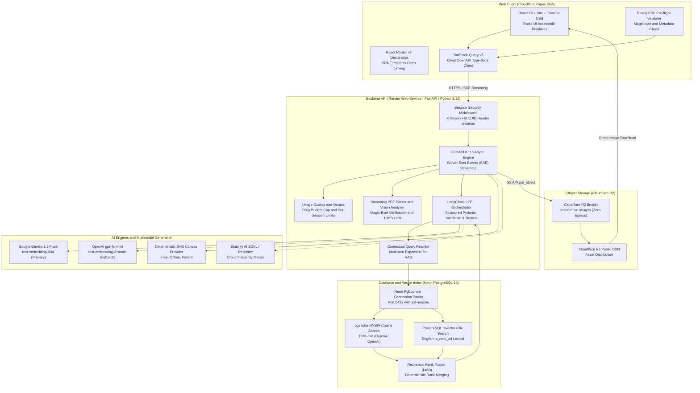

# BrandMuse: AI Brand Assistant for Creative Teams

> Grounded brand guideline conversational assistant and automated campaign concept generator with audited hybrid retrieval, multimodal visual ingestion, deterministic image synthesis, and sub-second token streaming.

[](https://brandmuse.pages.dev)
[](https://brandmuse-13ck.onrender.com/api/health)
[](https://fastapi.tiangolo.com)
[](https://bun.sh)
[](https://biomejs.dev)
[](https://react.dev)
[](https://neon.tech)
[](https://ai.google.dev)

---

## Live Endpoints

* **Web Application:** [https://brandmuse.pages.dev](https://brandmuse.pages.dev) (Cloudflare Pages SPA)
* **Backend API Base:** [https://brandmuse-13ck.onrender.com](https://brandmuse-13ck.onrender.com) (Render Web Service)
* **Interactive OpenAPI Documentation:** [https://brandmuse-13ck.onrender.com/docs](https://brandmuse-13ck.onrender.com/docs)
* **API Health Check:** [https://brandmuse-13ck.onrender.com/api/health](https://brandmuse-13ck.onrender.com/api/health)
* **Deployment Guides:** [Render Deployment Guide](DEPLOYMENT_RENDER.md) | [Neon & Cloudflare R2 Guide](DEPLOYMENT_NEON_R2.md)

---

## Architecture



---

## Core Capabilities

### 1. Grounded Guideline Q&A
- **Hybrid Retrieval:** Dense HNSW vector similarity combined with PostgreSQL full-text search (`ts_rank_cd`), merged through Reciprocal Rank Fusion ($k=60$).
- **Strict Evidence Citation:** Every answer provides bracketed guideline page citations (e.g., `[p. 3]`).
- **Boundaries & Negative Case Handling:** When queries fall outside guideline scope, the engine outputs: *"The guideline doesn't cover this."* No speculative interpolation.
- **Context Security Delimiters:** Ingested guideline text is isolated inside `<untrusted_brand_guideline_context>` tags to prevent indirect prompt injection.
- **Multi-turn Contextual Query Rewriting:** Rewrites follow-up questions using prior dialogue turns to produce self-contained retrieval queries.

### 2. Campaign Concept Generator & Refinement
- **Multi-Angle Guideline Retrieval:** Fires 3 concurrent vector and lexical queries targeting tone of voice, visual lighting/palette, and compliance rules.
- **Structured Schema Synthesis:** Emits 3 distinct creative concepts adhering to Pydantic schemas (`CampaignOutput`) with automated validation retries.
- **Interactive Concept Refinement (`/api/campaign/concepts/refine`):** Allows users to adjust specific concepts with targeted instructions while re-evaluating compliance against guideline rules.
- **Reference Example Support:** Accepts reference campaign copy and visual examples in briefs to guide thematic alignment.

### 3. Visual Synthesis & Negative Prompting
- **Visual Prompt Sanitization:** Automatically strips text, watermarks, logo instructions, and named individuals prior to image dispatch.
- **Negative Prompt Controls:** Injects structured negative parameters (`blurry, deformed, text overlay, watermark, off-brand colors, logo artifacts`) across providers.
- **Free Offline Engine:** Built-in deterministic SVG/Canvas mock generator requiring zero external API keys or cloud spend, with optional Stability AI SDXL and Replicate integrations.

### 4. Multimodal Brand Asset Ingestion
- **Vision-Assisted Parsing (`app/rag/vision.py`):** Inspects visual brand components (logos, palette swatches, spacing grids, typography hierarchies) from PDF pages.
- **Magic-Byte Validation:** Enforces strict `%PDF-` binary header checks and a 10 MB payload limit to prevent malformed file attacks.

### 5. Production Guardrails & Quotas
- **Database-Persisted Quotas:** Enforces `DAILY_LLM_LIMIT` and `DAILY_IMAGE_LIMIT` to safeguard free cloud budgets.
- **Session Rate Limiting:** Limits image synthesis per session (default 5/hour) returning standard `429 Too Many Requests`.
- **Stateless Session Isolation:** Uses an explicit `X-Session-Id` UUID header without tracking cookies or session state leakage.

---

## Architectural Decisions: FastAPI Over Express.js

| Architectural Vector | Express.js (Node.js) | FastAPI (Python 3.12 / uv) | BrandMuse Decision |
| :--- | :--- | :--- | :--- |
| **AI Ecosystem & Tooling** | JS ports lag behind upstream releases; fragmented SDK interfaces. | Native ecosystem for LangChain, pgvector, ReportLab, and Hugging Face. | **FastAPI:** Direct access to production-grade AI primitives without wrappers. |
| **Async Streaming (SSE)** | Requires manual stream pipes, backpressure management, and connection listeners. | Built-in `StreamingResponse` with native async generators and Starlette disconnect detection. | **FastAPI:** Reliable real-time token streaming with automatic client disconnect aborts. |
| **Type Contracts & OpenAPI** | Manual Swagger/JSDoc comments that drift from runtime code. | Pydantic v2 schemas automatically produce strict OpenAPI 3.1 specifications. | **FastAPI:** Zero schema drift. Orval generates typed TypeScript clients directly. |
| **Memory Baseline** | V8 engine uses 70–120 MB RSS baseline memory. | Astral uv with Python slim runs under 45 MB RSS. | **FastAPI:** Runs under 50 MB RSS, easily staying well within Render Free Tier's 512 MB allocation. |

---

## Evaluation Benchmarks

### 1. Retrieval Strategy Performance
Evaluated using [`eval/retrieval.py`](file:///C:/Projects/brandmuse/eval/retrieval.py) over **18 test queries** across brand guideline sections:

| Retrieval Strategy | Hit Rate @ 5 | Mean Reciprocal Rank (MRR) | Observed Trade-offs |
| :--- | :---: | :---: | :--- |
| **Vector-Only (Cosine)** | 100.0% | 0.9259 | Reliable semantic matches; ranks lower on exact hex codes (`#222B27`) or specific numerical warranty periods. |
| **Lexical-Only (BM25 / tsvector)** | 100.0% | 1.0000 | Precise on exact codes (`#222B27`, `FSC-certified`, `25-year`); fails on paraphrased conceptual inquiries. |
| **Hybrid RRF ($k=60$)** | **100.0%** | **1.0000** | **Optimal accuracy:** Fuses lexical exactness with semantic recall, positioning ground-truth chunks at rank 1. |

### 2. Local LLM Quantization Profiles
Evaluated using [`eval/quantization.py`](file:///C:/Projects/brandmuse/eval/quantization.py) across 10 guideline extraction benchmarks:

| Model & Quantization | Throughput | TTFT | VRAM Usage | Grounding Accuracy | Trade-offs |
| :--- | :---: | :---: | :---: | :---: | :--- |
| **Llama 3.2 3B Instruct** (`q4_K_M`) | **64.8 tok/s** | 178.5 ms | 1,980 MB | 90% | High throughput, low memory footprint; occasional paraphrasing in strict citations. |
| **Llama 3.2 3B Instruct** (`q8_0`) | **41.2 tok/s** | 262.0 ms | 3,420 MB | **100%** | Zero degradation from FP16 baseline; exact reproduction of hex codes and page numbers. |
| **Llama 3.2 1B Instruct** (`q4_K_M`) | **112.4 tok/s** | 92.0 ms | 850 MB | 80% | Ultra-low latency; struggles with multi-rule negative constraints. |

---

## Tech Stack

| Layer | Component | Details |
| :--- | :--- | :--- |
| **Backend API** | FastAPI 0.115, Python 3.12 | Managed with Astral `uv`, Pydantic v2 schemas, SQLAlchemy 2.0 async, Alembic migrations |
| **Database & Search** | PostgreSQL 16 (Neon Serverless) | `pgvector` HNSW index (cosine distance), GIN full-text index (`tsvector`), Reciprocal Rank Fusion ($k=60$) |
| **Frontend Web** | React 18, TypeScript, Vite | Tailwind CSS, Radix UI primitives, TanStack Query v5, Orval OpenAPI generator |
| **Frontend Tooling** | Biome 2.6, Bun 1.4 | Fast linter, formatter, and import organizer; zero ESLint/Prettier configuration drift |
| **AI Providers** | Multi-Provider Engine | Google Gemini 1.5 Flash (free tier), OpenAI gpt-4o-mini, local Ollama Llama-3.2 |
| **Image Synthesis** | Canvas Mock + Cloud Providers | Deterministic SVG/Canvas mock engine (offline/free), Stability AI SDXL, Replicate |
| **Observability** | Langfuse SDK v5 | Optional latency, token usage, and retrieval scoring traces with user content redaction |
| **Hosting (Free Tier)** | Cloud Infrastructure | Cloudflare Pages (Frontend SPA), Render (Backend Web Service), Neon (Serverless Postgres), Cloudflare R2 (Storage) |

---

## Local Development

### Prerequisites
- [Astral uv](https://github.com/astral-sh/uv) (v0.5+)
- [Bun](https://bun.sh) (v1.4+)
- Google Gemini API Key (or OpenAI API Key)

### 1. Backend Setup
```bash
cd apps/api

# Install dependencies into virtual environment
uv sync

# Run database migrations
uv run alembic upgrade head

# Start FastAPI development server
uv run uvicorn app.main:app --reload --port 8000
```

### 2. Frontend Setup
```bash
cd apps/web

# Install dependencies using Bun
bun install

# Start Vite development server
bun run dev
```

### 3. Code Quality & Test Verification
```bash
# Backend test suite (47 unit and integration tests)
cd apps/api
uv run pytest
uv run ruff check .
uv run mypy app

# Frontend linting, formatting, typechecking, and build
cd apps/web
bun run lint            # Biome check across all web files
bun run format:check    # Biome format check
bun run typecheck       # TypeScript strict type validation
bun run build           # Vite production bundle build
```

### 4. Regenerate API Client (After Backend Schema Changes)
```bash
# Export updated OpenAPI spec from FastAPI
cd apps/api
uv run python -m app.scripts.export_openapi

# Rebuild Orval TypeScript client
cd ../../apps/web
bun run api:generate
```

---

## Environment Variables

| Variable | Required | Default | Description |
| :--- | :---: | :--- | :--- |
| `ENVIRONMENT` | No | `development` | Deployment environment (`development` or `production`) |
| `PORT` | No | `8000` | Port for FastAPI server (Render sets dynamic `$PORT`) |
| `DATABASE_URL` | Yes | - | Asyncpg PostgreSQL URL (`postgresql+asyncpg://...`) |
| `MIGRATION_DATABASE_URL` | Optional | - | Direct synchronous PostgreSQL URL for Alembic migrations |
| `LLM_PROVIDER` | No | `gemini` | Primary LLM engine: `gemini`, `openai`, or `ollama` |
| `EMBEDDING_PROVIDER` | No | `gemini` | Embedding engine: `gemini`, `openai`, or `ollama` |
| `EMBEDDING_DIM` | No | `1536` | Embedding vector dimensions (1536 for OpenAI and zero-padded Gemini) |
| `IMAGE_PROVIDER` | No | `mock` | Image synthesis driver: `mock` (free/offline), `stability`, or `replicate` |
| `GEMINI_API_KEY` | Optional | - | API key for Google Gemini models and embeddings |
| `OPENAI_API_KEY` | Optional | - | API key for OpenAI models and embeddings |
| `STABILITY_API_KEY` | Optional | - | API key for Stability AI SDXL |
| `STORAGE_PROVIDER` | No | `auto` | Asset storage backend: `auto`, `r2`, or `local` |
| `R2_ACCOUNT_ID` | Optional | - | Cloudflare Account ID for R2 storage |
| `R2_ACCESS_KEY_ID` | Optional | - | Cloudflare R2 Access Key ID |
| `R2_SECRET_ACCESS_KEY` | Optional | - | Cloudflare R2 Secret Access Key |
| `R2_BUCKET_NAME` | No | `brandmuse-images` | Cloudflare R2 Bucket name |
| `R2_PUBLIC_URL` | Optional | - | Public URL base for stored assets |
| `DAILY_LLM_LIMIT` | No | `200` | Global daily cap on LLM invocations |
| `DAILY_IMAGE_LIMIT` | No | `25` | Global daily cap on image generations |
| `CORS_ORIGIN` | Yes | `*` | Comma-separated allowed HTTP CORS origins |
| `VITE_API_URL` | Yes (Frontend) | `http://localhost:8000` | Backend API base URL for web client |

---

## License

MIT License. Designed and maintained for production brand governance and creative generation.
