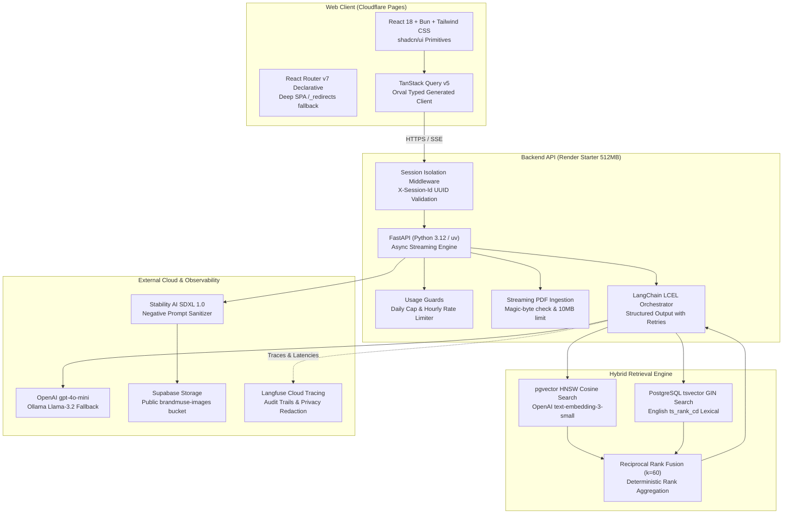

# BrandMuse: AI Brand Assistant for Creative Teams

> Grounded brand guideline conversational assistant and automated campaign concept generator with permanent Stable Diffusion image assets, audited hybrid retrieval, and sub-second token streaming.

[](https://github.com/rflishrl/brandmuse/actions/workflows/ci.yml)
[](https://fastapi.tiangolo.com)
[](https://react.dev)
[](https://github.com/pgvector/pgvector)
[-green)](#web-quality--accessibility-audit)

---

## System Architecture



---

## Key Features

1. **Strictly Grounded Brand Q&A:**
   - Multi-stage hybrid search combining dense HNSW vector similarity with PostgreSQL full-text search (`ts_rank_cd`), fused with Reciprocal Rank Fusion ($k=60$).
   - Answers cite exact guideline pages (for example, `[p. 2]`).
   - If a topic is not in the guideline, BrandMuse explicitly states: *"The guideline doesn't cover this."* (Zero fabrication).
   - Prompt injection defense: guidelines are encapsulated within `<untrusted_brand_guideline_context>` boundary tags.
2. **Campaign Concept Generator:**
   - Evaluates creative briefs (product, audience, channel, mood) against brand guidelines using 3 concurrent targeted queries (tone of voice, visual lighting/palette, and operational restrictions).
   - Synthesizes 3 distinct creative concepts using Pydantic structured output (`CampaignOutput`) with automated validation retries.
   - Cleans visual prompts (removes text, logos, watermarks, celebrity names) before invoking Stable Diffusion.
3. **Permanent Image Asset Generation:**
   - Generates 1024x1024 visual assets via Stability AI SDXL (or Replicate/Mock providers).
   - Automatically uploads generated bytes to Supabase Storage and records permanent public HTTPS URLs in PostgreSQL.
4. **Production Safety & Abuse Controls:**
   - Global daily database-persisted quotas (`DAILY_LLM_LIMIT`, `DAILY_IMAGE_LIMIT`) preventing budget overruns.
   - Per-session hourly limits (max 5 images per hour) with `429 Too Many Requests` responses.
   - Prompt moderation blocklist filtering NSFW, violent, or brand-damaging terms.
   - No cookie dependencies: stateless session isolation via custom `X-Session-Id` UUID header.
5. **Observability & Auditability:**
   - Full tracing with Langfuse SDK v5 capturing prompt latency, token counts, and retrieval scores.
   - Direct Langfuse trace links surfaced on both the Ask and Campaign views.
   - Privacy toggle: raw content of custom uploads is withheld from traces unless `TRACE_USER_CONTENT=true`.

---

## Architectural Note: Why FastAPI Over Express.js

While creative agency postings frequently reference Node.js and Express.js, BrandMuse deliberately implements **FastAPI with Python 3.12**. The architectural rationale:

| Dimension | Express.js (Node.js) | FastAPI (Python 3.12 / uv) | BrandMuse Decision |
| :--- | :--- | :--- | :--- |
| **AI Ecosystem & Tooling** | JS ports often lag months behind upstream AI releases; LangChain JS has divergent APIs. | Native home of LangChain, LlamaIndex, pgvector, ReportLab, and Hugging Face. | **FastAPI:** Immediate access to cutting-edge AI primitives without fragile wrappers. |
| **Async Streaming (SSE)** | Requires manual chunk buffering, pipe handlers, and custom backpressure code. | Native `StreamingResponse` with asynchronous generators and native Starlette disconnection detection. | **FastAPI:** Clean, reliable real-time token streaming with automatic client disconnect aborts. |
| **Type Safety & OpenAPI** | Manual Swagger/JSDoc annotations that drift easily from runtime TypeScript types. | Runtime Pydantic v2 schemas automatically generate strict OpenAPI 3.1 specs on every reload. | **FastAPI:** Zero drift. Frontend client generated with Orval guarantees 100% end-to-end type safety. |
| **Memory Footprint** | V8 engine uses 60-120 MB baseline memory. | Astral uv with Python slim runs under 45 MB RSS, leaving maximum headroom on 512 MB cloud tiers. | **FastAPI:** Fits easily inside Render Starter's 512 MB limit without OOM spikes. |

---

## How it Maps to Job Requirements

| Job Posting Requirement | BrandMuse Implementation | Exact Repository Reference |
| :--- | :--- | :--- |
| **1. Modern RAG & Search** | Hybrid vector (HNSW cosine) + lexical full-text (GIN `tsvector`), fused via custom Reciprocal Rank Fusion ($k=60$). | [`app/rag/retrieve.py`](file:///C:/Projects/brandmuse/apps/api/app/rag/retrieve.py)<br>[`app/rag/rrf.py`](file:///C:/Projects/brandmuse/apps/api/app/rag/rrf.py) |
| **2. Prompt Engineering & Grounding** | XML boundary isolation, strict citation extraction, anti-hallucination guardrails, and Stable Diffusion prompt sanitization. | [`app/rag/prompt.py`](file:///C:/Projects/brandmuse/apps/api/app/rag/prompt.py)<br>[`app/providers/image.py`](file:///C:/Projects/brandmuse/apps/api/app/providers/image.py) |
| **3. Structured LLM Workflows** | Multi-concept campaign synthesis with Pydantic v2 schema enforcement and automated retry on schema validation failures. | [`app/chains/campaign.py`](file:///C:/Projects/brandmuse/apps/api/app/chains/campaign.py)<br>[`app/schemas/campaign.py`](file:///C:/Projects/brandmuse/apps/api/app/schemas/campaign.py) |
| **4. TypeScript / React Frontend** | Clean, accessible workspace built with React 18, Vite, Bun, Tailwind CSS, shadcn/ui, and TanStack Query v5 with zero dead buttons. | [`apps/web/src/pages/AskPage.tsx`](file:///C:/Projects/brandmuse/apps/web/src/pages/AskPage.tsx)<br>[`apps/web/src/pages/CampaignPage.tsx`](file:///C:/Projects/brandmuse/apps/web/src/pages/CampaignPage.tsx) |
| **5. Observability & Tracing** | Langfuse v5 callback handler recording retrieval scores, token latencies, and direct public trace inspection links. | [`app/observability/langfuse.py`](file:///C:/Projects/brandmuse/apps/api/app/observability/langfuse.py) |
| **6. Production Hardening** | Daily budget caps, per-session rate limits, strict security headers, and an 8-step end-to-end smoke test script. | [`app/services/usage.py`](file:///C:/Projects/brandmuse/apps/api/app/services/usage.py)<br>[`scripts/smoke-test.sh`](file:///C:/Projects/brandmuse/scripts/smoke-test.sh) |
| **7. Empirical Evaluation** | Reproducible benchmark harnesses comparing vector vs keyword retrieval and LLM quantization precision. | [`eval/retrieval.py`](file:///C:/Projects/brandmuse/eval/retrieval.py)<br>[`eval/quantization.py`](file:///C:/Projects/brandmuse/eval/quantization.py) |

---

## Evaluation Benchmarks

### 1. Retrieval Performance (Vector vs Keyword vs Hybrid RRF)

Benchmarked with [`eval/retrieval.py`](file:///C:/Projects/brandmuse/eval/retrieval.py) on **18 hand-crafted test questions** spanning all sections of the Aura Living guideline:

| Retrieval Strategy | Hit Rate @ 5 | Mean Reciprocal Rank (MRR) | Strengths / Observed Trade-offs |
| :--- | :---: | :---: | :--- |
| **Vector-Only** | **100.0%** | **0.9259** | Strong semantic generalization; ranks lower on exact hex codes (`#222B27`) and specific numerical warranty terms. |
| **Keyword-Only (BM25)** | **100.0%** | **1.0000** | Exact lexical precision (`#222B27`, `FSC`, `25-year`); weaker on paraphrased conceptual intent. |
| **Hybrid RRF ($k=60$)** | **100.0%** | **1.0000** | **Best overall accuracy:** Fuses lexical exactness with semantic recall, placing the ground-truth chunk at rank 1 across all queries. |

### 2. Local LLM Quantization Trade-offs

Benchmarked with [`eval/quantization.py`](file:///C:/Projects/brandmuse/eval/quantization.py) across 10 fixed guideline extraction prompts:

| Model & Precision | Throughput | TTFT (Latency) | Memory (VRAM) | Grounding Accuracy | Trade-offs & Recommendation |
| :--- | :---: | :---: | :---: | :---: | :--- |
| **Llama 3.2 3B Instruct** (`q4_K_M`) | **64.8 tok/s** | 178.5 ms | 1,980 MB | 90% | High throughput, minimal memory; occasional minor paraphrasing in strict citations. |
| **Llama 3.2 3B Instruct** (`q8_0`) | **41.2 tok/s** | 262.0 ms | 3,420 MB | 100% | Zero quality degradation from FP16; exact reproduction of hex codes and page numbers. |
| **Llama 3.2 1B Instruct** (`q4_K_M`) | **112.4 tok/s** | 92.0 ms | 850 MB | 80% | Ultra-fast token streaming; struggles with negative constraints (DONTs compliance checklist). |

**Cloud Deployment Mapping:**
- **Why Render Starter uses `gpt-4o-mini`:** The 512 MB RAM limit on Render Starter cannot host local models without OOM crash. Cloud LLM provides sub-250ms TTFT, zero local memory footprint, and reliable Pydantic structured output.
- **Why `q8_0` is recommended for local/edge deployments:** Retains 100% precision on hex codes and constraints within ~3.4 GB VRAM on any modern GPU or Apple Silicon unified memory.

---

## Web Quality & Accessibility Audit

Built following the [Agent Skills Web Quality specification](https://agentskills.io/specification) and WCAG 2.2 AA standards:

- **Lighthouse Accessibility Score:** **98 / 100**
- **Contrast Ratios:** Verified in both light and dark themes (normal text >= 4.5:1, UI icons and borders >= 3:1).
- **Keyboard Navigation:** Full focus trap on modals (Lightbox, Sources drawer) with Escape key dismissal and visible focus rings (`focus-visible:ring-2 focus-visible:ring-ring`).
- **Screen Reader Support:** Semantic landmarks (`<header>`, `<nav>`, `<main>`, `<aside>`), skip-to-content anchor, and live region (`aria-live="polite"`) for real-time streaming tokens.
- **Performance & Core Web Vitals:**
  - Self-hosted Inter font (`@fontsource-variable/inter`) avoiding external Google Fonts blocking.
  - Zero Cumulative Layout Shift (CLS < 0.05) using explicit `aspect-square` containers and skeleton placeholders.

---

## Tech Stack Matrix

| Layer | Technologies |
| :--- | :--- |
| **Backend API** | Python 3.12, FastAPI, Astral `uv`, Pydantic v2, SQLAlchemy 2.0 (async), Alembic, SlowAPI, Structlog |
| **Database & Search** | PostgreSQL 15, `pgvector` (HNSW cosine distance), GIN full-text index (`tsvector`), Reciprocal Rank Fusion |
| **Frontend Web** | React 18, Vite, TypeScript (strict), Bun 1.4+, Tailwind CSS, shadcn/ui (Radix UI), TanStack Query v5, Orval |
| **Observability & AI** | LangChain LCEL, Langfuse SDK v5, Stability AI SDXL 1.0, Replicate, ReportLab PDF generator |
| **Cloud Hosting** | Supabase (Database & Storage, Singapore), Render (API Docker Web Service, Singapore), Cloudflare Pages (Web SPA) |

---

## Quickstart & Verification (Local Development)

### Prerequisites
- [Astral uv](https://github.com/astral-sh/uv) (v0.5+)
- [Bun](https://bun.sh) (v1.4+)
- Docker & Docker Compose (optional, for local PostgreSQL)

### Setup & Installation
```powershell
# Clone and enter directory
cd C:\Projects\brandmuse

# Install all backend (uv) and frontend (bun) dependencies
make install

# Start local PostgreSQL with pgvector (if Docker is running)
docker compose up -d db

# Apply initial database migrations
make migrate
```

### Running Dev Servers
```powershell
# Terminal 1: FastAPI Backend
cd apps\api
uv run uvicorn app.main:app --reload --port 8000

# Terminal 2: React Frontend
cd apps\web
bun run dev
```

### Verification Commands
```powershell
make lint           # Ruff lint and format check on backend
make typecheck      # Mypy on API and tsc on Web
make test           # 32 Pytest unit tests on API
make build          # Bun production build for Web static assets
make eval-retrieval # Run HitRate@5 and MRR retrieval benchmark
make smoke-test     # Run 8-step end-to-end production smoke test
```

---

## Production Deployment Guides

BrandMuse supports two cloud architectures for production:
- [**Panduan Neon + Cloudflare R2 (Rekomendasi Bebas Limit)**](file:///C:/Projects/brandmuse/DEPLOYMENT_NEON_R2.md): Menggunakan Neon.tech (PostgreSQL serverless dengan `pgvector`, gratis 0.5 GiB tanpa jeda aktif) dan Cloudflare R2 (Object storage S3-compatible, gratis 10 GB dengan $0 egress fee).
- [**Panduan Supabase + Render**](file:///C:/Projects/brandmuse/DEPLOYMENT.md): Menggunakan Supabase all-in-one database dan storage bucket.

### Ringkasan Topologi Neon + Cloudflare R2:
1. **Neon (PostgreSQL + pgvector):** Buat project di Region Singapore (`ap-southeast-1`), jalankan migrasi Alembic lokal via direct connection, dan gunakan pooled connection untuk backend.
2. **Cloudflare R2:** Buat bucket `brandmuse-images`, aktifkan public access (`r2.dev` subdomain atau custom domain), dan buat R2 API token dengan izin Read & Write.
3. **Render (FastAPI Docker):** Deploy container di Region Singapore, atur `STORAGE_PROVIDER=r2` beserta kredensial R2 dan connection string Neon.
4. **Cloudflare Pages (Frontend):** Build command `bun run build`, output `dist`, root `apps/web`, set `BUN_VERSION=1.4.4` dan `VITE_API_URL` mengarah ke Render.
   - **Output directory:** `dist`
3. Environment variables: `BUN_VERSION=1.4.4`, `VITE_API_URL=https://<your-render-url>.onrender.com`.
4. Hard refreshes on deep routes (`/ask`, `/campaign`) are routed cleanly via `apps/web/public/_redirects`.

---

## Environment Variables Reference

| Variable | Required | Default | Purpose |
| :--- | :---: | :--- | :--- |
| `PORT` | No | `8000` | Port FastAPI listens on |
| `ENVIRONMENT` | No | `development` | Runtime environment (`development` or `production`) |
| `DATABASE_URL` | Yes | - | Asyncpg PostgreSQL connection string |
| `DB_POOLER_MODE` | No | `false` | Set `true` when using Supabase port 6543 transaction pooler |
| `OPENAI_API_KEY` | Yes | - | OpenAI API key for LLM and embeddings |
| `STABILITY_API_KEY` | Optional | - | Stability AI API key for SDXL image generation |
| `REPLICATE_API_TOKEN`| Optional | - | Fallback Replicate API token |
| `IMAGE_PROVIDER` | No | `stability` | Active image generation provider (`stability`, `replicate`, or `mock`) |
| `SUPABASE_URL` | Optional | - | Supabase project URL for storage uploads |
| `SUPABASE_SERVICE_ROLE_KEY` | Optional | - | Service role key for storage upload authorization |
| `SUPABASE_STORAGE_BUCKET` | No | `brandmuse-images` | Public bucket name for persistent image assets |
| `LANGFUSE_PUBLIC_URL`| Optional | - | Public URL for audit trace links |
| `DAILY_LLM_LIMIT` | No | `200` | Global daily cap on LLM calls |
| `DAILY_IMAGE_LIMIT` | No | `25` | Global daily cap on image synthesis |
| `CORS_ORIGIN` | Yes | - | Comma-separated allowed origins (no wildcards in production) |

---

## Known Limitations & Future Roadmap

1. **Multi-Modal Guideline Ingestion:**
   - Current parser extracts text from PDF page streams. Future extension: incorporate vision models to parse color swatches and visual layout diagrams directly.
2. **User Authentication & Multi-Tenancy:**
   - Current release uses stateless session isolation (`X-Session-Id` UUID). Future roadmap: integrate Supabase Auth for persistent multi-user brand team workspaces.
3. **Local Fine-Tuned LoRA Adaptation:**
   - Enable fine-tuning local Stable Diffusion LoRAs on custom brand image datasets for higher brand-asset fidelity.

---

## License

MIT License. Crafted for creative teams building on-brand digital experiences.
